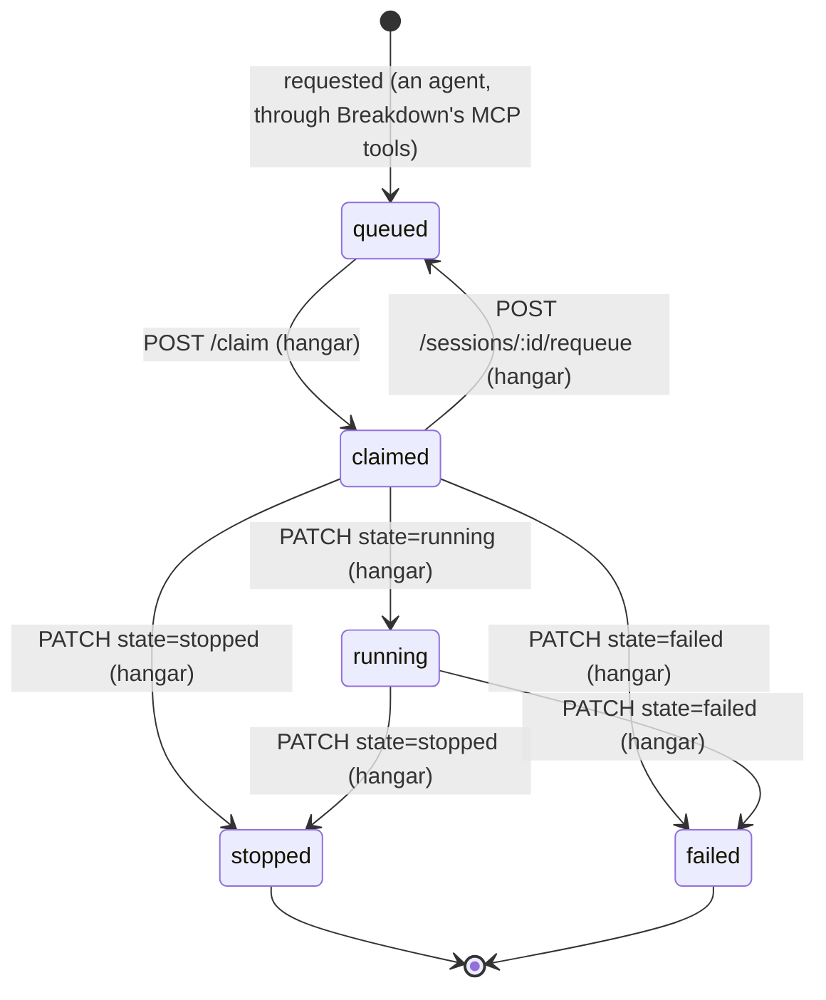

# Hangar API, v1

Breakdown is the control plane for **hangar**, the service that runs remote Claude sessions on a machine that only connects out. This document is the HTTP contract between them. You can build a client from it without reading Breakdown's code. A test (`apps/web/server/hangar-contract.test.ts`) fails whenever an endpoint is added to or removed from the server without the same change here.

## Who calls what

There are two callers, and each holds its own token.

- **Hangar**, the service, holds a `hangar`-scoped token. It checks in, claims queued session requests, reports each session's state as it runs, and lists the sessions it holds so it can reconcile after a restart.
- **A worker**, the Claude session inside a container that hangar started, holds the **session token** that hangar received when it claimed that session. The token is `agent`-scoped and bound to that one session. The worker uses it to read its session's messages here. It also uses it for Breakdown's MCP server and the inbox scripts (see [Session tokens](#session-tokens)).

Every request goes from hangar's side to Breakdown. Breakdown never connects to hangar, so hangar can sit behind NAT and be offline for long stretches. Work queues here until hangar comes back.

## Base URL, transport, and authentication

The API is served by Breakdown's **web** server (the one that serves the board and tRPC), not the MCP server, under the path prefix `/hangar/v1/`:

```
http://<breakdown-host>:<port>/hangar/v1/...      # the web server directly (default port 4310)
https://<breakdown-host>/hangar/v1/...            # behind a TLS proxy such as `tailscale serve`
```

- **Port.** Use the web server's port: `--port`, default 4310. The MCP server (default 5320) has no `/hangar/v1/` routes. When Breakdown runs as the container app (`docker-compose.app.yml`, the SkyOS app), the web port is `BREAKDOWN_WEB_PORT` (default 4310), and compose publishes it at that same number on the host. The hostname hangar uses must be listed in `BREAKDOWN_ALLOW_HOSTS`, which the launcher turns into `--allow-host` (see [Host](#base-url-transport-and-authentication) below).
- **Health.** `GET /healthz` on the same port takes a token of any scope, including the `hangar` token, so hangar can probe Breakdown before it checks in. It is not part of this API's contract and answers in Breakdown's own format.

- **Authentication.** Every request carries `Authorization: Bearer <token>`. A missing, unknown, or revoked token gets `401` with `WWW-Authenticate: Bearer`. A live token whose scope the endpoint does not accept gets `403`. Tokens never go in a query string, which is ignored.
- **Scopes.** Each endpoint takes exactly one scope: `hangar` for the service endpoints, and `agent` with a bound session for `GET /hangar/v1/messages`. Breakdown's other scope, `human`, is refused on every endpoint here. The `hangar` token is refused everywhere else in Breakdown, except `GET /healthz`: the web API's other routes and MCP.
- **Requests must arrive off loopback.** Breakdown trusts a request from its own machine (loopback peer, loopback `Host`) without reading any token, and treats it as the local person (`human`), so every endpoint here refuses it with `403`. Hangar reaches Breakdown over the tailnet, from another machine. If a proxy on Breakdown's machine fronts the server, it must set `X-Forwarded-For` (or `X-Real-IP` / `Forwarded`) to the remote address, which `tailscale serve` does. **A forwarder that adds no such header (socat, `ssh -R`, a bare nginx `proxy_pass`) is unsafe and must not be used.** It makes every remote request look local, so every peer that can reach it is the tokenless local person on the web API (tRPC) and on MCP: it can read the whole store and make every decision a person makes, with no token at all. Its requests to the endpoints here are refused, but that is the least of it.
- **Host.** The `Host` header must be a name the operator allowed with `--allow-host`, either at the server's port or bare (a proxy on 443). Any other `Host` gets `403`, token or not. Use the tailnet hostname Breakdown is served under.
- **Content.** Every response body is JSON (`Content-Type: application/json; charset=utf-8`, `Cache-Control: no-store`). `POST` and `PATCH` requests must send `Content-Type: application/json` and a UTF-8 JSON body of at most 64 KiB (65,536 bytes). `GET` requests send no body. Unknown request fields are ignored, and responses may carry fields this document does not list yet; ignore those (see [Versioning](#versioning)).
- **Read-only servers.** A Breakdown started with `BRAIN_READ_ONLY` answers `GET`s and refuses every `POST` and `PATCH` with `403 read_only`. That includes check-in and claim, so to hangar a read-only Breakdown has no work.

## Endpoints

| Method | Path | Scope | Purpose |
| --- | --- | --- | --- |
| `POST` | `/hangar/v1/check-in` | `hangar` | Report liveness, version, capacity |
| `POST` | `/hangar/v1/claim` | `hangar` | Take the oldest queued request of a flavor you can run (long-poll) |
| `PATCH` | `/hangar/v1/sessions/:id` | `hangar` | Report a claimed session's state and placement |
| `POST` | `/hangar/v1/sessions/:id/requeue` | `hangar` | Give a claimed session back to the queue with a reason |
| `GET` | `/hangar/v1/sessions` | `hangar` | List the sessions you hold, for reconciliation |
| `GET` | `/hangar/v1/messages` | `agent` (session token) | A worker reads its session's messages (long-poll) |

`:id` is a session id, a lowercase uuid (uppercase is accepted). A path segment that is not a uuid gets `404 not_found`. A known path with the wrong method gets `405 method_not_allowed` with an `Allow` header. Any other path under `/hangar/v1/` gets `404 not_found`, including one with a trailing slash.

### The session object

Every endpoint that returns a session uses this shape. Times are UTC ISO-8601 with milliseconds (`2026-11-14T09:00:00.000Z`) and come from the clock of Breakdown's database. Optional fields are `null` when unset, never absent.

```json
{
  "id": "3f0c2a9e-6f7d-4a54-9a0b-1c2d3e4f5a6b",
  "state": "running",
  "flavor": "headless",
  "repo": "cazzer/bd",
  "work_item": {
    "id": "8b1e4c1d-2f3a-4b5c-8d9e-0a1b2c3d4e5f",
    "external_id": "bd-d38.3",
    "source_system": "beads",
    "title": "Hangar queue, sessions, check-ins, messages"
  },
  "container": "c-12",
  "host": "hangar-linux",
  "disk_path": "/var/lib/hangar/disks/3f0c2a9e.img",
  "requeue_reason": null,
  "failure_reason": null,
  "claimed_by": "hangar-desktop",
  "claimed_at": "2026-11-14T09:00:01.250Z",
  "requested_at": "2026-11-14T08:59:40.000Z"
}
```

| Field | Type | Meaning |
| --- | --- | --- |
| `id` | uuid | The session id. Use it in `:id` paths. |
| `state` | string | `queued`, `claimed`, `running`, `stopped`, or `failed` (see [the state machine](#session-state-machine)). |
| `flavor` | string | `headless`, `display-godot`, or `display-browser`: the kind of environment the session needs. |
| `repo` | string | The repository to work in, as the requester named it (e.g. `owner/name`). It is free text that Breakdown does not check, so hangar must check it against its allowlist before cloning (see [the claim](#post-hangarv1claim--scope-hangar)). |
| `work_item` | object or null | The work item the session runs for. `id` is Breakdown's node id. `external_id` and `source_system` say where it came from (for a beads issue, `source_system` is `beads`). `null` only if the link was removed. |
| `container`, `host`, `disk_path` | string or null | Where it runs, as hangar last reported it. |
| `requeue_reason` | string or null | Why it was last given back to the queue: the reason hangar sent, or `claimer disconnected before receiving the claim` when Breakdown gave it back itself (see [Long-poll](#long-poll)). Cleared when it is claimed again. |
| `failure_reason` | string or null | Why a claim could not take it and set it `failed` (see [the claim](#post-hangarv1claim--scope-hangar)). `null` for every other session, including one hangar reported `failed`. |
| `claimed_by` | string or null | The name of the hangar that holds it: the client name of that hangar's token. `null` while queued. |
| `claimed_at` | time or null | When it was last claimed. |
| `requested_at` | time | When it was requested. Claims take the oldest first, and a requeued session keeps its place. |

### `POST /hangar/v1/check-in` — scope `hangar`

Tells Breakdown hangar is alive, which version it runs, and its capacity. Call it on the interval the response gives (see [Check-ins and status](#check-ins-and-status)). Each claim attempt also counts as a check-in, but a claim records no version or capacity.

Request:

```json
{ "version": "0.4.1", "capacity": { "disk_free_gb": 120, "slots": { "headless": 2, "display-browser": 1 } } }
```

- `version` (string, 1–200 characters, required): hangar's version.
- `capacity` (object or `null`, optional): opaque to Breakdown for now. It is stored as given, up to 10,000 characters serialized. Omitted or `null` clears the stored capacity.

Response `200`:

```json
{ "interval_s": 30, "now": "2026-11-14T09:00:00.000Z" }
```

- `interval_s`: how many seconds to wait before the next check-in. Always use this value over your own setting.
- `now`: the time Breakdown's database recorded this check-in at, for logging skew. Never use your own clock to judge liveness.

Status codes: `200`, `400 invalid_json` / `invalid_request`, `401`, `403 forbidden` / `read_only`, `413`, `415`.

### `POST /hangar/v1/claim` — scope `hangar`

Takes the oldest queued session whose flavor is one you name, and returns it with its session token. The claim waits up to `wait_s` seconds for a matching request to arrive (see [Long-poll](#long-poll)). Under racing claims, each queued session goes to exactly one claimer. Every attempt also counts as a check-in for the hangar named by your token.

Request:

```json
{ "flavors": ["headless", "display-browser"], "wait_s": 25 }
```

- `flavors` (array, required): 1 to 3 distinct values from `headless`, `display-godot`, `display-browser`. Name only flavors you can start now. Breakdown does not track capacity, so the choice is yours.
- `wait_s` (integer, 0–30, default 0): how long to wait for a match. `0` answers at once. Send `25`: a long-poll answers within about a second of a request arriving and costs one connection while it waits. If you send `0`, sleep at least 1 s between claims (see [Long-poll](#long-poll)).

Response `200`, claimed:

```json
{
  "session": { "id": "3f0c2a9e-6f7d-4a54-9a0b-1c2d3e4f5a6b", "state": "claimed", "flavor": "headless", "repo": "cazzer/bd", "work_item": { "id": "8b1e4c1d-2f3a-4b5c-8d9e-0a1b2c3d4e5f", "external_id": "bd-d38.3", "source_system": "beads", "title": "Hangar queue, sessions, check-ins, messages" }, "container": null, "host": null, "disk_path": null, "requeue_reason": null, "failure_reason": null, "claimed_by": "hangar-desktop", "claimed_at": "2026-11-14T09:00:01.250Z", "requested_at": "2026-11-14T08:59:40.000Z" },
  "token": "bdt_Zk3…"
}
```

Response `200`, nothing to claim within `wait_s`:

```json
{ "session": null }
```

- A queued session that cannot be claimed (its stored record breaks the session contract or Breakdown's size limits, or a live token already holds its `session-<id>` client name) is set to `failed` with its `failure_reason` recorded, and the claim goes on to the next match. Fields that break the contract or the limits are dropped from the failed record. A claim passes over at most a few such sessions per attempt.
- **Hangar MUST allowlist `repo` before cloning.** Any MCP agent, not only a person, can queue a request (`brain_hangar_request`), and `repo` is whatever text it sent. Breakdown checks only its length. Before you clone anything or start a worker, check `repo` against your own list of repositories you are willing to run. If it is not on the list, report the session `failed` with `PATCH`. Don't requeue it, because another claim would take it again.
- `token` is the session token, returned **only in this response**. Breakdown stores only its hash, so it cannot be shown again. Store it before anything else, and see [Session tokens](#session-tokens) for what to do if you lose it.
- A claimed session is `claimed`. Report `running` once the worker starts, or [requeue](#post-hangarv1sessionsidrequeue--scope-hangar) it if you cannot start it.

Status codes: `200`, `400 invalid_json` / `invalid_request`, `401`, `403 forbidden` / `read_only`, `413`, `415`, `429 too_many_waiters` (see [Long-poll](#long-poll)).

### `PATCH /hangar/v1/sessions/:id` — scope `hangar`

Reports a session's state and where it runs. Only the hangar that claimed the session may change it. Every change is recorded in the session's history, attributed to your hangar.

Request (every field optional, at least one required):

```json
{ "state": "running", "container": "c-12", "host": "hangar-linux", "disk_path": "/var/lib/hangar/disks/3f0c2a9e.img" }
```

- `state`: the state to move to. The [state machine](#session-state-machine) decides which moves are allowed. Sending the current state is allowed, and leaves the state as it is while you update the other fields.
- `container`, `host` (string, at most 200 characters), `disk_path` (string, at most 1,024 characters): a string sets the field, `null` or `""` clears it, and an omitted field is left as it is. Values are trimmed and must not contain control characters.

Response `200`:

```json
{ "session": { "id": "3f0c2a9e-6f7d-4a54-9a0b-1c2d3e4f5a6b", "state": "running", "container": "c-12", "host": "hangar-linux", "disk_path": "/var/lib/hangar/disks/3f0c2a9e.img", "…": "…" } }
```

Moving to `stopped` or `failed` revokes the session token in the same transaction. The worker's next request with it gets `401`.

Status codes:
- `200`
- `400 invalid_json` / `invalid_request`: for example, an empty body `{}`
- `401`
- `403 forbidden` / `read_only` / `not_claimer`: another hangar holds the session, or nobody does, as with a queued one
- `404 not_found`: no session has that id
- `409 invalid_transition`: the move is not allowed, and the message names both states
- `413`, `415`

### `POST /hangar/v1/sessions/:id/requeue` — scope `hangar`

Gives a claimed session back to the queue when you cannot start it, for example because there is no disk budget or the image failed to pull. The session becomes `queued` again with `requeue_reason` set. Its `claimed_by`, `claimed_at`, `container`, `host`, and `disk_path` are cleared, and its session token is revoked. It keeps its `requested_at`, so it keeps its place in line, and the next matching claim, yours or another hangar's, can take it. You can requeue only from `claimed`. Once a session is `running`, end it with `failed` instead.

Request:

```json
{ "reason": "disk budget full" }
```

- `reason` (string, 1–500 characters, required): shown to people on the session.

Response `200`: `{ "session": { …, "state": "queued", "requeue_reason": "disk budget full", "claimed_by": null, … } }`

Status codes: `200`, `400 invalid_json` / `invalid_request`, `401`, `403 forbidden` / `read_only` / `not_claimer`, `404 not_found`, `409 invalid_transition` (the session is not `claimed`), `413`, `415`.

A requeued session keeps its id, so whoever claims it next runs the same logical session. That claimer's worker gets a new token bound to the same session id. It reads the same message stream: messages sent to the earlier worker are there, and `after=0` returns all of them. It reads from its own saved cursor, which starts at `0` for a fresh worker. It can also re-send and complete the inbox items the earlier worker filed. This is intended. The session's work and the person's decisions on it belong to the session, not to one container. A worker that starts on a requeued session should read its history before acting.

### `GET /hangar/v1/sessions` — scope `hangar`

Lists the sessions your hangar holds, newest-changed first. Use it at startup to reconcile with what you are actually running.

Query parameters:
- `state` (repeatable, e.g. `?state=claimed&state=running`): which states to list. Defaults to `claimed` and `running`, the sessions you still hold open. Ask for `stopped` or `failed` by name to see ended ones. Queued sessions belong to no hangar, so `?state=queued` lists nothing.
- `limit` (integer, 1–200, default 50).

Other parameters are ignored. Giving `limit` twice is a `400`.

Response `200`:

```json
{ "sessions": [ { "id": "3f0c2a9e-6f7d-4a54-9a0b-1c2d3e4f5a6b", "state": "running", "…": "…" } ], "truncated": false }
```

- `truncated`: more sessions matched than `limit`. Raise `limit` or narrow `state`.

Status codes: `200`, `400 invalid_request` (an unknown state, or a bad `limit`), `401`, `403 forbidden`.

### `GET /hangar/v1/messages` — scope `agent`

A worker reads its own session's messages, waiting up to `wait_s` seconds for one to arrive. The token must be a session token, from a claim. Any other `agent` token gets `403 forbidden`. The session is always the token's own, and any session named in the request is ignored, so one session can never read another's messages.

Query parameters:
- `after` (integer ≥ 0, default 0): the `cursor` from your previous read, or `0` to read from the start.
- `wait_s` (integer, 0–30, default 0): how long to wait when there is nothing after `after`. Send `25`. If you send `0`, sleep at least 1 s between reads.

Example: `GET /hangar/v1/messages?after=118&wait_s=25`

Response `200`:

```json
{
  "messages": [
    {
      "id": 119,
      "kind": "inbox_decision",
      "body": {
        "item_id": "5d6e7f80-1a2b-4c3d-9e8f-7a6b5c4d3e2f",
        "title": "Ship the hangar contract?",
        "decision": "accept",
        "outcome": "accepted",
        "option": "b",
        "message": "go, but keep v1 additive",
        "text": "[inbox] Accepted option b: \"Ship the hangar contract?\". Note: go, but keep v1 additive Carry it out now, then run: inbox done 5d6e7f80-1a2b-4c3d-9e8f-7a6b5c4d3e2f \"<what you did, with link>\""
      },
      "created_at": "2026-11-14T09:12:30.512Z"
    }
  ],
  "cursor": 119
}
```

Nothing arrived within `wait_s`: `{ "messages": [], "cursor": 118 }`. The cursor is unchanged.

Status codes: `200`, `400 invalid_request` (a bad `after` or `wait_s`), `401` (the token is revoked, for example because the session stopped), `403 forbidden` (not a session token), `429 too_many_waiters`.

#### Message kinds

`kind` says how to read `body`. Today there is one kind. Ignore kinds you don't know, since new ones may be added within v1.

`inbox_decision`: a person acted on an inbox item this session filed. The worker files items through the web API's `inboxRequest` with its session token, for example `bin/inbox request` with `BREAKDOWN_TOKEN` set.

| Body field | Meaning |
| --- | --- |
| `item_id` | The inbox item's id. |
| `title` | The item's title. |
| `decision` | What the person did: `accept`, `changes` (sent back with a note), `dismiss`, `release` (moved from held to waiting on them, unread), or `session` (they took it over in a local session). |
| `outcome` | The item's status afterwards: `accepted`, `changes`, `dismissed`, `pending`, or `session`. |
| `option` | Present only on an accept of a card with options: the chosen option's id. |
| `message` | The person's note, or `""`. |
| `text` | A ready-made instruction for the worker's Claude session: what was decided and the command that closes the loop (e.g. `inbox done <id> "<what you did>"`). On `session`, it tells the worker to stop work on the item. |

After a `session` message the item belongs to a local session. Later decisions on it do not come here, and the worker must not complete it.

Decisions reach a session only while it is open. Once it is `stopped` or `failed`, nobody reads its messages. An accept or a send-back (`changes`) on an item it filed is then refused with `CONFLICT` and nothing is written: "The hangar session that filed this has ended. Hand it off to a local session or dismiss it." A remote worker's proposal never quietly turns into an execution on Breakdown's host with the person's credentials. The person can still dismiss the item, release it if it is held, or hand it off to a local session. None of these sends a message, and each one unbinds the item from the session. From then on the item is local. That is the person's explicit choice, so a later accept of a released item is an ordinary local accept.

## Long-poll

`POST /claim` (`wait_s` in the body) and `GET /messages` (`wait_s` in the query) long-poll:

- **Bound.** `wait_s` is an integer from 0 to 30. Larger values get `400`.
- **Early answer.** Breakdown checks once a second, and answers as soon as a claim succeeds or a message arrives, typically within about a second of it arriving. Otherwise it answers empty when `wait_s` passes.
- **Use `wait_s: 25`.** That is the recommended value for both endpoints. The default is `0`, which answers at once.
- **Re-poll.** After a long-poll (`wait_s` above 0) answers, empty or not, send the next one straight away. With `wait_s: 0`, an empty answer comes back at once, so sleep at least 1 second before the next request.
- **At most 4 at once.** One client (one token) may hold at most 4 long-polls open at a time, claims and message reads together. A fifth gets `429 too_many_waiters` with `Retry-After: 1`. A request with `wait_s: 0` does not count. One outstanding long-poll per loop is all a client needs.
- **Timeouts.** Set your HTTP client's timeout above `wait_s`, for example `wait_s + 10` seconds.
- **No claim after disconnect.** If you close the connection, Breakdown stops before its next attempt, so it never claims for a request whose caller is gone. If a claim completes just as the connection closes, Breakdown sees that it cannot answer and requeues the session at once, with `requeue_reason` `claimer disconnected before receiving the claim`, and the token it minted is revoked. One narrow window remains: if the answer is written but lost in transit, you never receive the token. That session shows up as `claimed` by you in [`GET /sessions`](#get-hangarv1sessions--scope-hangar); requeue it.
- **Shutdown.** When Breakdown shuts down, an open long-poll answers empty early, and the next request fails to connect. Retry with backoff.

## Cursor semantics

- Message ids are integers, ascending in the order messages were appended to the session. They are not contiguous, because the sequence is shared across sessions.
- A read returns the session's messages with `id > after`, oldest first, at most 50. `cursor` is the id of the last one returned, or `after` unchanged when none were.
- If a read returns 50 messages, read again at once with the new cursor before waiting.
- Delivery is **at-least-once**. Save the cursor only after you have handled the messages, and de-duplicate by `id`: after a crash you will see some messages again. The cursor never skips a message.
- Messages are kept. Reading does not remove them, and `after=0` replays the session's history.

## Session state machine



- **Who sets what.** A request (from an agent, through Breakdown) creates a `queued` session. Only a claim moves it to `claimed`, and only a requeue moves it back to `queued`. Hangar reports everything else with `PATCH`, and only the claiming hangar can.
- **Forward only.** A `PATCH` may move a session forward along `claimed → running → stopped`, may skip `running` (`claimed → stopped`), and may set `failed` from any state except `stopped`. It cannot set `queued` or `claimed`. Any other move is `409 invalid_transition`, and the session is unchanged. `stopped` and `failed` are final.
- **Requeue** only from `claimed`.
- **Token revocation.** The session token is revoked in the same transaction that moves the session to `stopped` or `failed`, or requeues it. A requeued session claimed again gets a new token. The old one stays dead.
- Every state change is a revision of the session in Breakdown's history, attributed to the hangar that made it.

## Check-ins and status

- **Interval.** Check in every `interval_s` seconds, taken from the latest check-in response. It is 30 today. The server's value always wins over your own setting.
- **Claims count.** Every claim attempt, including each one-second retry inside a long-poll, counts as a check-in. It updates the time only, not version or capacity.
- **Offline rule.** Breakdown reports hangar `online` while its last check-in is less than three intervals old (90 s today), `offline since <last check-in>` after that, and `never` before the first one. Every time is the clock of Breakdown's database. Hangar's clock is never used, so skew between the machines does not matter.
- Breakdown shows this status to agents (MCP) and on its web board. A request made while hangar is offline still queues. It waits for the next claim.

## Session tokens

- **One per claim.** A successful claim mints a new token, returned once in that response. Its client name is `session-<session id>`, its scope is `agent`, and it is bound to that session.
- **Give it to the worker.** Pass it into the container that runs the session. It is the worker's only credential. With it, the worker can:
  - read its messages here, with `GET /hangar/v1/messages`;
  - use Breakdown's MCP server (`Authorization: Bearer <token>` on `/mcp`, port 5320 by default), where its writes are attributed to `session-<id>`;
  - file and complete inbox requests with the inbox scripts (`BREAKDOWN_API=<web base URL> BREAKDOWN_TOKEN=<token> bin/inbox request …`). An item filed this way is bound to the session, and the person's decision on it arrives as an `inbox_decision` message. The token can re-send and complete only items its own session filed. A key that names another session's item, or a local or ingested one, is refused, and nothing is written.

  It cannot decide anything a person decides: no agent write, with any token, can set an inbox item to `accepted`, `changes`, or `dismissed`, or write its feedback. A new item is always `pending`. It cannot use the hangar endpoints.
- **What it can reach.** A session token is a full `agent` credential on MCP, minus two tools. It can read the whole store, including every inbox item, not only its session's, and it can write nodes and edges anywhere outside the reserved hangar ones. It cannot call `brain_merge` or `brain_hangar_request`. Those tools are neither listed nor run for it, so it cannot merge nodes or queue more sessions. Treat it as a credential that can read and write your knowledge store, and hand it only to the worker it was minted for.
- **A leaked hangar token mints these.** Anyone holding the `hangar` token can claim queued sessions and receive their session tokens. To stop that, revoke the hangar token (`pnpm -s client-token revoke <hangar name>`). Its sessions' tokens die as those sessions end. Revoke a session token on its own with `pnpm -s client-token revoke session-<id>`.
- **Lifetime.** The token dies when the session reaches `stopped` or `failed`, or is requeued. After that, every request with it gets `401`.
- **Lost a token?** Breakdown cannot show it again. On startup, and whenever you are unsure, call `GET /hangar/v1/sessions?state=claimed`. Requeue any `claimed` session you hold no token for, with a reason such as `"hangar restarted before starting it"`, and a later claim gets a fresh token. For a `running` session whose worker lost its token, report `failed`.

## Minting the hangar token

On the machine that runs Breakdown, from its checkout:

```bash
pnpm -s client-token create hangar-desktop --scope hangar   # prints bdt_… once on stdout; only its hash is stored
pnpm -s client-token list                                   # client, scope, bound session, created, last used, live/revoked
pnpm -s client-token revoke hangar-desktop                  # stops this hangar at once
```

The client name, here `hangar-desktop`, is the hangar's identity. Names starting with `session-` are reserved for the tokens claims mint, and `create` refuses them. Breakdown records it as `claimed_by` and as the hangar's name in check-ins, and it is attributed with every change the hangar makes. Each client has one live token. To rotate, revoke and create again. Tokens are managed only on that host: no API endpoint, MCP tool, or web procedure creates, lists, or revokes one, except the session tokens that claims mint.

## Errors

Every error response has this body:

```json
{ "error": { "code": "invalid_transition", "message": "hangar session cannot move from \"stopped\" to \"running\"" } }
```

Branch on `code`, which is stable within v1. `message` is for people, and its wording may change.

| Status | `code` | When |
| --- | --- | --- |
| 400 | `invalid_json` | The body is not valid UTF-8 JSON. |
| 400 | `invalid_request` | The JSON or query string breaks the endpoint's schema: a required field is missing, or a documented field has the wrong type or is out of range. The message lists each problem as `field: reason`. An unknown field is not an error (see [Versioning](#versioning)). |
| 401 | `unauthorized` | No token, or an unknown or revoked one. Sent with `WWW-Authenticate: Bearer`. |
| 403 | `forbidden` | The token's scope cannot call this endpoint, the request arrived over loopback (where no token is read; reach Breakdown through the tailnet host or a proxy that sets `X-Forwarded-For`), or the `Host` / `Origin` is not allowed. |
| 403 | `read_only` | The server is read-only and this is a `POST` or `PATCH`. |
| 403 | `not_claimer` | The session is held by another hangar, or by none. |
| 404 | `not_found` | No such endpoint, or no session with that id (a malformed id included). |
| 405 | `method_not_allowed` | A known path with the wrong method. The `Allow` header lists the right ones. |
| 409 | `invalid_transition` | The state change breaks the [state machine](#session-state-machine). |
| 413 | `too_large` | The body is over 64 KiB, declared or sent. The connection is closed. |
| 415 | `unsupported_media_type` | A `POST` or `PATCH` without `Content-Type: application/json`. |
| 429 | `too_many_waiters` | This client already holds 4 long-polls open (see [Long-poll](#long-poll)). Sent with `Retry-After: 1`. |
| 500 | `internal` | A server fault. It is logged on Breakdown's side, and you can retry with backoff. |

## Versioning

- Everything here is under `/hangar/v1/`. A breaking change gets a new prefix (`/hangar/v2/`), served alongside v1 until hangar moves.
- Hangar and Breakdown are deployed independently, so either side may be newer than the other. Within v1, both directions tolerate what they don't know:
  - **Requests.** Breakdown ignores a request body field it does not know. A newer hangar can send a field this server predates, and the request still succeeds as if the field were absent. Documented fields are still checked: a missing required field, a wrong type, or an out-of-range value is a `400 invalid_request`. So check a field's name against this document: a misspelled optional field is ignored, not refused.
  - **Responses.** Responses may gain fields, messages may gain kinds, and error messages may be reworded. Clients must ignore fields and kinds they don't know.
- A field changes meaning or type only under a new prefix.
